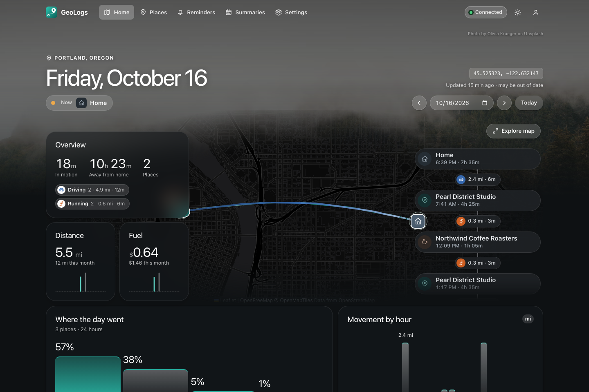
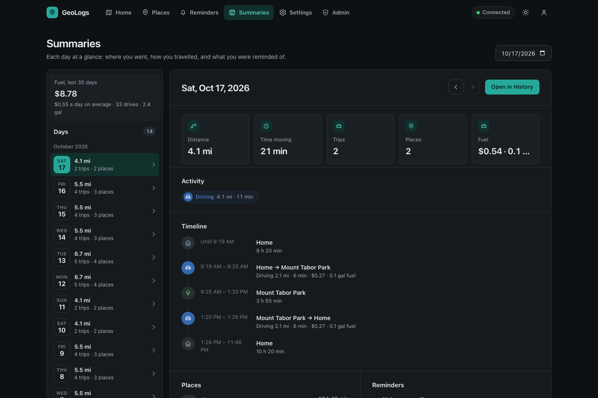
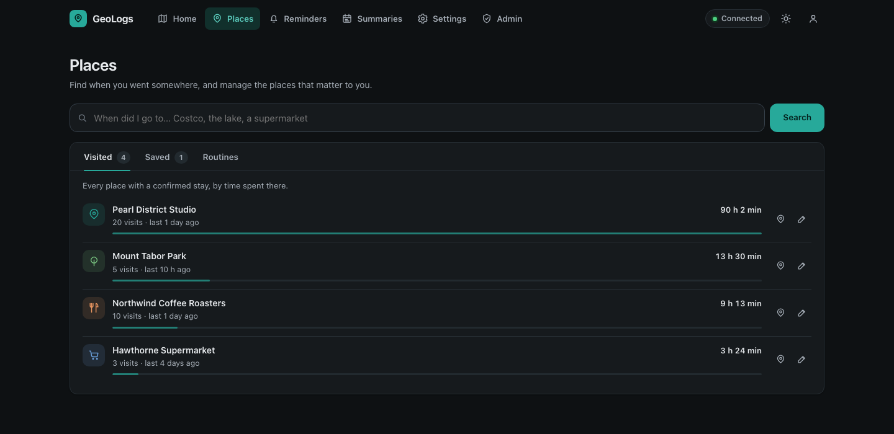

# GeoLogs

A self-hosted location archive for you, your family or a small community. Your phone sends where it is; GeoLogs keeps it, works out where you stayed and how you travelled, and lets you (or an AI assistant) ask about it.

Your history stays in a PostgreSQL database that you run. Nothing is sent to anyone unless you turn on a service that needs it, and each person sees only their own data.

## What it does

-   **Collects locations** from the apps you may already use: [OwnTracks](https://owntracks.org/), [Overland](https://github.com/aaronpk/Overland-iOS), Traccar Client, OsmAnd, GPSLogger, Home Assistant, or any script that can send an HTTP request. Import a CSV, Google Takeout's `Records.json`, or Google's newer Timeline export from your phone, right in the browser; export everything as CSV, GPX or GeoJSON.
-   **Understands the day.** It finds stays (sitting still, or moving around one place, such as a lake loop), the trips between them, and how you travelled: walking, running, cycling or driving. It shows each day with a map, a timeline, speed while driving, and the places you visited.
-   **Names places.** Save your own, or let a provider (Geoapify, Mapbox or your own Photon) name visits. Search your history: "what day did I go to Costco?".
-   **Reminds you on arrival.** "Remind me to buy salt when I get to the supermarket" fires when your phone arrives, as a browser notification or a webhook.
-   **Summaries and costs.** Each day, month and year at a glance: a calendar of how far you went, the places and towns you spent time in, and the fuel cost of your drives.
-   **Maps your places.** A heat map of where you go, your saved zones, and the routes you take most.
-   **Warns when a tracker goes quiet**, by browser notification, email or webhook, so a phone app that stopped sending is noticed the same day.
-   **Installs on your phone** as an app, and opens the days you last looked at without a connection.
-   **Answers questions through MCP.** Connect Claude or any other [MCP](https://modelcontextprotocol.io/) client and ask about your own history.
-   **Is multi-user.** Accounts with email sign-in, invites, password reset, two-factor sign-in and an admin portal. Admins see how much each person recorded, never where. The database itself enforces that users cannot read each other's rows.

## Screenshots



| | |
| --- | --- |
|  |  |
| **Summaries**: a month with its towns, calendar and places | **Places**: a heat map of where you go, beside your visits |

*The screenshots show made-up data for a fictional person.*

## Quick start

You need Docker with Compose.

```bash
git clone https://github.com/karunstha/geologs.git
cd geologs
cp .env.example .env
```

Edit `.env` and set three secrets to long random values (`openssl rand -base64 32 | tr -d '/+='` makes one): `POSTGRES_PASSWORD`, `GEOLOGS_APP_DB_PASSWORD` and `GEOLOGS_TOKEN`. Set `GEOLOGS_TIMEZONE` to your timezone, such as `America/Chicago`. Then:

```bash
docker compose up --build -d
```

Open [http://127.0.0.1:8765](http://127.0.0.1:8765), choose **Sign in with the server's access token**, and enter `GEOLOGS_TOKEN`. Open the account button at the top right to add your email and a password, so you can sign in without the token from then on.

## Connect a phone

In **Settings → Devices**, GeoLogs shows the address and settings for each supported app. For example, in OwnTracks (HTTP mode) the address is `https://your-server/api/ingest/owntracks`; create a device token under **Settings → Access** and use it as the password. Phones outside your home network need an address that works from the internet, over HTTPS: see [Deploying](docs/deploying.md#putting-it-on-the-internet).

Details for every app, Home Assistant, CSV and Takeout imports, and the HTTP API for your own scripts are in [Connecting trackers](docs/trackers.md).

## Use it with an AI assistant

GeoLogs speaks MCP at `/mcp`. Create a personal API token on your account page, then point an MCP client at it:

```json
{
  "mcpServers": {
    "geologs": {
      "url": "https://your-server/mcp",
      "headers": { "Authorization": "Bearer YOUR_API_TOKEN" }
    }
  }
}
```

The assistant can read your history, search visits, and manage reminders, as you and no one else. See [MCP and the API](docs/mcp-and-api.md).

## Documentation

[Deploying](docs/deploying.md)

Docker Compose, running without Docker, HTTPS and reverse proxies, backups, updating

[Configuration](docs/configuration.md)

Every setting

[Connecting trackers](docs/trackers.md)

Phone apps, Home Assistant, imports, device tokens

[Accounts](docs/accounts.md)

Users, invites, email, two-factor sign-in, the admin portal

[How GeoLogs works](docs/how-it-works.md)

Stays, trips, places, reminders, geocoding, fuel costs

[MCP and the API](docs/mcp-and-api.md)

Assistants, the REST API, reminder webhooks

[Privacy](docs/privacy.md)

Who can see what, and what leaves your server

[Upgrading](docs/upgrading.md)

Steps for versions that need more than a restart

[Architecture](docs/architecture.md)

How the code is organised

[Development](docs/development.md)

Setting up, running the tests

## Contributing

Bug reports and pull requests are welcome. [Development](docs/development.md) explains how to run the tests, which need Docker, and [Architecture](docs/architecture.md) the rules the code keeps (an architecture test enforces them). For a vulnerability, see [SECURITY.md](SECURITY.md) and report it privately.

## License

GeoLogs is free software under the [GNU Affero General Public License, version 3 or later](LICENSE). You may use, study, change and share it. If you run a modified version as a service that other people use, you must offer them its source code.

Copyright © 2026 Karun Shrestha.